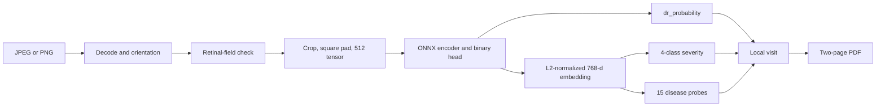

<div align="center">
  <h1>OFFIRST</h1>
  <h2>Offline retinal screening for Android</h2>
  <h3>Learn More From Less Data</h3>
  <p><strong>Team OFFIRST | ZEISS BeyondCode 2026</strong></p>
  <p>
    
    
    
  </p>
</div>

OFFIRST 1.0.5 is an offline Android research prototype. On the phone it registers patients, screens retinal photographs, stores visits, and writes a two-page PDF. Inference stays on the device.

The current source is version **1.0.5+2005**, package `org.offirst.offline_dr_screening`, app label **OFFIRST**. It runs a frozen FP32 KD768 encoder and scores the same L2-normalized 768-d embedding with a binary DR head, a 4-class severity probe, and 15 exploratory disease probes.

> **Research use only.** OFFIRST is not a certified medical device and has not been clinically validated. Do not use it to diagnose or rule out disease, determine referrals, or guide treatment. A score below a threshold does not rule out diabetic retinopathy.

## Download OFFIRST for Android

| Phone | Download |
| --- | --- |
| ARM64 (`arm64-v8a`) | [Download universal APK](https://github.com/Mayank-gitspace/OFFIRST/releases/download/offirst-v2.1/OFFIRST-v2.1-final-candidate.apk) |
| ARMv7 (`armeabi-v7a`) | [Download the same universal APK](https://github.com/Mayank-gitspace/OFFIRST/releases/download/offirst-v2.1/OFFIRST-v2.1-final-candidate.apk) |

[Release notes](https://github.com/Mayank-gitspace/OFFIRST/releases/tag/offirst-v2.1) · [SHA-256 manifest](https://github.com/Mayank-gitspace/OFFIRST/releases/download/offirst-v2.1/OFFIRST-v2.1-final-candidate.sha256) · [Installation guide](docs/INSTALLATION.md)

The file is one universal APK for both ARM64 and ARMv7 phones. It needs Android 7.0 or newer and is debug-signed. APK SHA-256: `c165bc145ce2fdf6115585594aa4048e728abd0422576f485d36be587c6c77e2`.

That download is app version **1.0.3** (version code 2003), from the [offirst-v2.1](https://github.com/Mayank-gitspace/OFFIRST/releases/tag/offirst-v2.1) release. The source described below is **1.0.5+2005**. A 1.0.5 APK is not attached to Releases yet.

## Contents

- [Download OFFIRST for Android](#download-offirst-for-android)
- [What this build does](#what-this-build-does)
- [Screening modes](#screening-modes)
- [Model in this build](#model-in-this-build)
- [Image check and preprocessing](#image-check-and-preprocessing)
- [Visit PDF](#visit-pdf)
- [Build 1.0.5](#build-105)
- [Older releases](#older-releases)
- [Recorded results](#recorded-results)
- [Repository](#repository)

## What this build does

The app has five tabs: Home, Patients, Screening, Experts, and About. The first launch walks through those areas, adding a patient, choosing a screening mode, adding right-eye (OD) and left-eye (OS) images, saving a visit, opening the PDF actions, and the associated expert. Skip and Done both mark the tour complete.

A screening visit can hold several images for each eye. Each image is scored on its own. The app keeps patient records, visit images, and reports in app-private storage. There is no account system, no cloud inference, and no application-level encryption.

The on-screen notice is: “Experimental AI screening only. A result below threshold does not rule out diabetic retinopathy. This output is not a diagnosis or a basis for treatment. Get a qualified eye-care assessment, regardless of the score.”

## Screening modes

Both modes use one cached embedding from the ONNX model. Changing mode does not run the encoder again.

| Mode | What the screen shows |
| --- | --- |
| DR severity | Default. Four-class grade: Healthy, Mild, Moderate, or Severe. Colour badge, confidence, a four-bar breakdown, and Any DR risk = 1 − P(Healthy). |
| Multi-disease | Summary badge **Any Disease Risk**, then 14 findings sorted by displayed risk. The DR row uses the four-class grade. The other rows use Low, Borderline, Elevated, or High. |

Severity colours are `#22C55E`, `#EAB308`, `#F97316`, and `#EF4444`.

On the multi-disease screen, Hypertension uses its prevalence-matched cutoff. Every other finding uses the greater of its Youden cutoff and 0.35. Low is below that cutoff. Borderline runs up to the greater of cutoff + 0.15 and 0.70. Elevated runs up to 0.88. High is at or above 0.88.

**MH is Media Haze.** The fifteen labels are Any Disease Risk, Diabetic Retinopathy, Age-Related Macular Degeneration, Pathological Myopia, Glaucoma, Cataract, Hypertensive Retinopathy, Media Haze, Drusen, Branch Retinal Vein Occlusion, Tessellation (Tigroid Fundus), Laser Scars, Optic Disc Cupping, Optic Disc Pallor, and Optic Disc Edema. These labels are exploratory probe outputs.

The binary `dr_probability` is still stored for each image. With the current model, positive means `dr_probability >= 0.524373471736908`. When an embedding is present, the tile shows the grade view.

## Model in this build

| Piece | Value in 1.0.5 |
| --- | --- |
| Encoder | MobileNetV3-Large KD Run 2 student. 960-d pooled features, bias-free linear map to 768, then L2 normalization. |
| ONNX asset | [offirst_v2_1_experimental.onnx](deployment/offline_dr_screening/assets/offirst_v2_1_experimental.onnx) |
| SHA-256 | `b6bcb1182db7717c01ef24181d79a44be7d1a75ddefe8567cfec2fffb9e5c59b` |
| Model id | `offirst-v2.1-experimental-b6bcb118` |
| Input | `fundus_image`, float32, `[1, 3, 512, 512]`, RGB, NCHW |
| Outputs | `dr_probability`, float32 `[1, 1]`; `embedding`, float32 `[1, 768]`, already L2-normalized |
| Binary head | Folded linear map 768 → 1, then sigmoid. The scaler is inside those weights. |
| Binary threshold | `0.524373471736908` |
| Severity probe | [kd768_lp_dr_severity4_aptos.json](deployment/offline_dr_screening/assets/heads/kd768_lp_dr_severity4_aptos.json), SHA-256 `b7f64ce49be8a11e2e9abebbdf8ea2b73fe3760b12b413c16df85b80afa2e388` |
| Severity rule | Softmax, then argmax. Severe covers ICDR grade 3 severe NPDR and grade 4 proliferative DR. The asset records 2,929 APTOS training examples. |
| Disease probes | [kd768_lp_multidisease_rfmid_odir.json](deployment/offline_dr_screening/assets/heads/kd768_lp_multidisease_rfmid_odir.json), SHA-256 `2eaf44e6b3343a5821c6f4988d149766e9c18be10d69a00a609424c66157a0cc` |
| Rollback asset | [offirst_dr_model.onnx](deployment/offline_dr_screening/assets/offirst_dr_model.onnx), SHA-256 `b8fc10191f69faef16f1dc92d08bf9542ee7e26f885767942e28292c5201dd90`, historical cutoff `0.48`. Selected only with `OFFIRST_EXPERIMENTAL_V21=false`. |

The KD checkpoint digest recorded in the model manifest is `8bc239d22ffc4e786820f2151c99380a754bef930e42edea65022e1246f2096d`. That checkpoint is on the [KD Run 2 release](https://github.com/Mayank-gitspace/OFFIRST/releases/tag/kd-run2). The phone loads the ONNX export.



The encoder lineage is a ConvNeXt-Tiny BYOL teacher, a MobileNetV3-Large student started from direct BYOL, and KD Run 2 distillation into the mobile student. Masked InfoNCE experiments in this repository are separate research. They are absent from this app’s inference path.

## Image check and preprocessing

Before the encoder runs, the app rejects an image that does not look like a retinal photograph. The message is: “This image does not look like a fundus photograph. Choose a retinal image.”

The check measures the corner surround. A gray camera border, one labeled corner, a tighter crop, a mild offset, and a darker retina can pass. A normal full-frame photo, a blank page, and a tiny speck fail. A retinal photo that fills the frame with no darker surround can also fail. This is a geometry check. No trained fundus detector is packaged. Accepted images keep the same crop and tensor as before the check.

An accepted image is then prepared in OpenCV: max-channel mask above 15, 5×5 opening, crop when the mask is large enough, square padding, resize through 640 and then 512 with `INTER_AREA`, ImageNet normalization, and planar RGB float32. The limits are JPEG or PNG and 24 megapixels. There is no packaged image-quality model. Blur, exposure, and clinical gradability are not scored.

## Visit PDF

Saving a visit can write `OFFIRST-{visit}-v6.pdf`, a two-page A4 report generated on the device.

- Page 1 has the report id, patient details, a colour DR severity index for the captured eyes, and the other screening findings.
- Page 2 shows the captured fundus photographs.
- Image quality is marked “Not assessed.”
- If that v6 file already exists for the visit, the app returns the saved file.

The report is a screening summary for a prototype. It has no role as a medical diagnosis.

## Build 1.0.5

Flutter 3.41.9, Dart 3.11.5, JDK 17, and the Android SDK. Minimum Android API is 24. Release builds are debug-signed prototype APKs.

```powershell
git clone https://github.com/Mayank-gitspace/OFFIRST.git
cd OFFIRST/deployment/offline_dr_screening
flutter pub get
flutter test
flutter build apk --release --split-per-abi --tree-shake-icons --build-name=1.0.5 --build-number=2005 --target-platform android-arm,android-arm64
```

The split APKs are written under `build/app/outputs/flutter-apk/`. Flutter’s split version code is `abiVersion * 1000 + 2005`: armeabi-v7a is **3005**, arm64-v8a is **4005**. A universal APK with version code 2005 does not replace an installed 4005 package.

To compile the v1.1 rollback on purpose:

```powershell
flutter build apk --release --dart-define=OFFIRST_EXPERIMENTAL_V21=false --build-name=1.0.5 --build-number=2005
```

`scripts/build_v2_1_final_candidate.ps1` still checks for 1.0.4. Use the Flutter command above for this 1.0.5 source.

## Older releases

| Release | What it is |
| --- | --- |
| [offirst-v2.1](https://github.com/Mayank-gitspace/OFFIRST/releases/tag/offirst-v2.1) | App 1.0.3, version code 2003. [Universal APK](https://github.com/Mayank-gitspace/OFFIRST/releases/download/offirst-v2.1/OFFIRST-v2.1-final-candidate.apk), SHA-256 `c165bc145ce2fdf6115585594aa4048e728abd0422576f485d36be587c6c77e2`. ONNX SHA-256 `43a87f05df7adc6a231a679721e7f0b11b45a3fe6d1582aa4527ed738fa63b3f`. Threshold `0.3675977844516245`. 16-unit MLP with Platt calibration inside the graph. |
| [offirst-android-prototype-v1.1](https://github.com/Mayank-gitspace/OFFIRST/releases/tag/offirst-android-prototype-v1.1) | Older binary model and APKs. Historical cutoff `0.48`. |
| [kd-run2](https://github.com/Mayank-gitspace/OFFIRST/releases/tag/kd-run2) | Student checkpoint used by the encoder lineage. The phone does not load this file directly. |

## Recorded results

The table below is the historical assessment of the earlier binary classifiers. It does not measure the 1.0.5 linear head or the JSON probes. Patient independence was not established. IDRiD and RFMiD use different label protocols.

| Classifier | Dataset | Images | Accuracy | Sensitivity | Specificity | AUROC | Threshold |
| --- | --- | ---: | ---: | ---: | ---: | ---: | ---: |
| v1.1 | IDRiD | 72 | 70.83% | 57.45% | 96.00% | 0.846 | 0.48 |
| Earlier v2.1 | IDRiD | 72 | 79.17% | 87.23% | 64.00% | 0.874 | 0.3675977844516245 |
| v1.1 | RFMiD | 69 | 86.96% | 100.00% | 84.48% | 0.967 | 0.48 |
| Earlier v2.1 | RFMiD | 69 | 81.16% | 54.55% | 86.21% | 0.875 | 0.3675977844516245 |

Those earlier v2.1 numbers missed the combined working gates of 85% accuracy, 85% sensitivity, and 80% specificity. Accuracy, sensitivity, specificity, and AUROC for the current 1.0.5 head are not established in this repository.

These rows compare encoder representations. They are separate from the 1.0.5 screening scores:

| Evaluation | Direct BYOL MobileNetV3 | KD Run 2 MobileNetV3 |
| --- | ---: | ---: |
| RFMiD linear-probe AUROC | 0.917 | 0.932 |
| RFMiD 10-shot AUROC | 0.640 | 0.728 |
| ARMD 10-shot AUROC | 0.789 | 0.949 |

Details and caveats are in [docs/RESEARCH_RESULTS.md](docs/RESEARCH_RESULTS.md), [OFFIRST_PREDICTION_RECOVERY.md](OFFIRST_PREDICTION_RECOVERY.md), and [OFFIRST_DATA_LINEAGE_AND_EXPOSURE_MATRIX.csv](OFFIRST_DATA_LINEAGE_AND_EXPOSURE_MATRIX.csv).

## Repository

| Path | Contents |
| --- | --- |
| [deployment/offline_dr_screening](deployment/offline_dr_screening) | Flutter app, Kotlin preprocessing, PDF generator, tests, and packaged models |
| [heads](heads) | Probe JSON used to build the app assets |
| [docs](docs) | Longer architecture, setup, and evaluation notes. Several of those notes still describe the 1.0.3 model. |
| [encoder_byol](encoder_byol), [encoder_mnv3_ssl](encoder_mnv3_ssl), [kd_run2](kd_run2) | Representation and distillation research |
| [encoder_baseline](encoder_baseline), [kd_imaging](kd_imaging), [lesion_segmenter](lesion_segmenter), [tools](tools) | Separate experiments. The 1.0.5 app leaves them out of the installed package. |

Patient records, visit images, build output, and APKs are ignored. The app stores them on the phone, outside this repository.

**Team OFFIRST · ZEISS BeyondCode 2026.** Dataset terms remain with each dataset. This prototype does not imply a ZEISS product.
