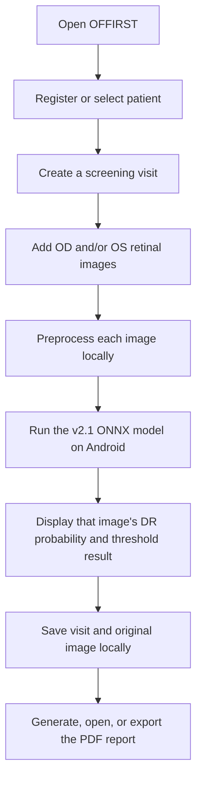

<div align="center">

# OFFIRST

### Offline AI-Powered Diabetic Retinopathy Screening

**Learn More From Less Data**

Team OFFIRST · ZEISS BeyondCode 2026

An experimental Android research prototype for local retinal image screening. OFFIRST combines an on-device DR classifier with local patient and visit management and PDF reports. It is not a clinically validated diagnostic application.

[](https://github.com/Mayank-gitspace/OFFIRST/releases/tag/offirst-v2.1)
[](deployment/offline_dr_screening/pubspec.yaml)
[](docs/AI_MODEL.md)
[](docs/KNOWN_LIMITATIONS.md)

## Download OFFIRST for Android

| Device architecture | Download |
| --- | --- |
| ARM64 Android phones | [Download universal APK](https://github.com/Mayank-gitspace/OFFIRST/releases/download/offirst-v2.1/OFFIRST-v2.1-final-candidate.apk) |
| ARMv7 Android phones | [Download the same universal APK](https://github.com/Mayank-gitspace/OFFIRST/releases/download/offirst-v2.1/OFFIRST-v2.1-final-candidate.apk) |

[Release notes](https://github.com/Mayank-gitspace/OFFIRST/releases/tag/offirst-v2.1) · [SHA-256 manifest](https://github.com/Mayank-gitspace/OFFIRST/releases/download/offirst-v2.1/OFFIRST-v2.1-final-candidate.sha256) · [Installation guide](docs/INSTALLATION.md)

APK SHA-256: `c165bc145ce2fdf6115585594aa4048e728abd0422576f485d36be587c6c77e2`

The single APK contains both `arm64-v8a` and `armeabi-v7a`. It is a debug-signed prototype build (Android 7.0+, API 24 minimum). Device installation and workflow checks remain unverified; see the release notes and [verification record](deployment/offline_dr_screening/FINAL_RELEASE_HANDOFF.md).

</div>

## Overview

Retinal screening can depend on specialist access, imaging equipment, and reliable connectivity. OFFIRST explores whether compact learned representations can support a local diabetic retinopathy screening workflow on an Android phone.

The application accepts retinal photographs, preprocesses each image on-device, runs an ONNX classifier without cloud inference, stores visits locally, and can generate a PDF report. Each image receives an independent model output; OFFIRST does not fuse multiple images into a patient-level prediction.

## What the application does

- Registers, searches, edits, and deletes local patient records with stable IDs.
- Creates screening visits and associates individual images with the right eye (OD) or left eye (OS).
- Runs offline v2.1 ONNX inference and records a separate DR probability, model ID, and threshold for each image.
- Saves visit images and metadata in app-private local storage and reopens visit history.
- Maintains a user-entered expert directory and patient–expert associations. Entries are unverified; recorded schedules are not live availability and an association does not imply clinical review.
- Generates, opens, and exports a PDF report with the recorded per-image results.

The application does not provide accounts, cloud synchronization, clinician verification, live appointment booking, absent-eye reason codes, a combined patient-level score, or multi-disease classification. The model output is a binary DR screening score, not a diagnosis.

## How OFFIRST works



Images are processed on the device. The application does not send images or records to a cloud inference service. Android image providers may themselves require connectivity to make a selected file available. Patient records, source images, and reports remain in app-private storage unless the user explicitly exports or shares a report. Exported PDFs can contain sensitive information.

## Deployed AI model

The primary application model is OFFIRST v2.1, an experimental DR-only classifier:

| Component | Deployed v2.1 configuration |
| --- | --- |
| Student encoder | MobileNetV3-Large, KD Run 2 epoch 40 |
| Teacher lineage | ConvNeXt-Tiny BYOL epoch 20; frozen 768-dimensional teacher features |
| Student initialization | Direct BYOL MobileNetV3-Large epoch 40 |
| Projection | Original 960 → 768 feature projection |
| Classifier | Supervised 16-unit MLP binary DR head |
| Calibration | Platt calibration integrated in the FP32 ONNX graph; applied once |
| Decision threshold | `0.3675977844516245`, positive at `>=` |
| Model SHA-256 | `43a87f05df7adc6a231a679721e7f0b11b45a3fe6d1582aa4527ed738fa63b3f` |

The v2.1 deployed lineage is BYOL plus knowledge distillation. KD Run 2 is not an explicit Masked InfoNCE experiment, and Masked InfoNCE is not part of the shipped v2.1 classifier. BYOL is non-contrastive self-supervised learning. Separate self-supervised and contrastive research material is preserved in the repository; it should not be read as the v2.1 application model. See [AI model details](docs/AI_MODEL.md) and [research results](docs/RESEARCH_RESULTS.md).

### Offline inference pipeline

```mermaid
flowchart LR
    A[Retinal image] --> B[OpenCV color decode]
    B --> C[RGB conversion and fundus crop/pad]
    C --> D[640 then 512 resize]
    D --> E[ImageNet normalization, NCHW float32]
    E --> F[MobileNetV3-Large encoder]
    F --> G[960 → 768 projection]
    G --> H[16-unit DR head and embedded Platt calibration]
    H --> I[ONNX probability]
    I --> J[Compare once with 0.3675977844516245]
    J --> K[Per-image result stored with model metadata]
```



The ONNX input is `fundus_image`, float32 `[batch, 3, 512, 512]`, RGB/NCHW. Its output is `dr_probability`, float32 `[batch, 1]`. The app consumes the calibrated probability directly and does not apply Platt calibration a second time. The v1.1 ONNX remains in the app assets and its published [release](https://github.com/Mayank-gitspace/OFFIRST/releases/tag/offirst-android-prototype-v1.1) is preserved as a rollback artifact. Saved images retain their model ID and cutoff so older v1.1 results keep their original interpretation.

## Experimental evaluation

The following application-level DR classifier results are development assessments, not independent clinical validation. Patient independence is unverified for both datasets, historical exposure exists, and IDRiD and RFMiD use different label protocols.

| Model | Dataset | Images | Accuracy | Sensitivity | Specificity | AUROC |
| --- | --- | ---: | ---: | ---: | ---: | ---: |
| v2.1 | IDRiD | 72 | 79.17% | 87.23% | 64.00% | 0.874 |
| v1.1 | IDRiD | 72 | 70.83% | 57.45% | 96.00% | 0.846 |
| v2.1 | RFMiD | 69 | 81.16% | 54.55% | 86.21% | 0.875 |
| v1.1 | RFMiD | 69 | 86.96% | 100.00% | 84.48% | 0.967 |

v2.1 does not meet the combined working gates of 85% accuracy, 85% sensitivity, and 80% specificity on either dataset. RFMiD sensitivity of 54.55% is a substantial false-negative limitation. The v1.1 RFMiD scores are also development-only and do not establish independent performance.

### Representation-learning results (separate from application metrics)

These frozen-encoder evaluation results are AUROC probes, not the accuracy or sensitivity of the deployed app classifier.

| Evaluation | Direct BYOL MobileNetV3 | KD Run 2 MobileNetV3 |
| --- | ---: | ---: |
| RFMiD linear-probe AUROC | 0.917 | 0.932 |
| RFMiD 10-shot AUROC | 0.640 | 0.728 |
| ARMD 10-shot AUROC | 0.789 | 0.949 |

The sets are development research evaluations with exposure and split limitations described in the [research documentation](docs/RESEARCH_RESULTS.md) and [KD Run 2 report](kd_run2/README.md). They do not establish clinical generalization.

## Technology stack

| Technology | Use |
| --- | --- |
| Flutter 3.41.9 / Dart 3.11.5 | Android application and local workflow |
| Kotlin / Android SDK | Android OpenCV preprocessing and native PDF actions |
| ONNX Runtime | Local FP32 model inference |
| OpenCV 4.12 | v2.1 image decode and preprocessing |
| Python / PyTorch | Model development and research experiments |
| Pillow / NumPy / scikit-learn | Research preprocessing and evaluation |
| JSON and app-private files | Local patient, expert, visit, image, and report storage |
| Kaggle | Documented model-development environment |

## Installation and usage

1. Download the universal ARM64/ARMv7 APK above and verify its SHA-256.
2. On Android 7.0 or newer, open the downloaded APK and allow installation from that browser or file manager if prompted.
3. Open **OFFIRST**, register or select a synthetic demonstration patient, and create a visit.
4. Select OD and/or OS, choose locally available de-identified retinal images, and run screening.
5. Review each image's result, save the visit, then open or export its PDF report.

The APK is debug-signed and intended for prototype testing. No Android phone or emulator was connected for this publication verification, so installation, physical-device preprocessing parity, offline runtime, upgrade data retention, and PDF opening/export have not been device-verified. See the [installation guide](docs/INSTALLATION.md) and [final release handoff](deployment/offline_dr_screening/FINAL_RELEASE_HANDOFF.md).

### Build from source

The normal Android release configuration selects v2.1 by default. From the repository root:

```powershell
cd deployment/offline_dr_screening
flutter pub get
dart format --output=none --set-exit-if-changed lib test
flutter analyze
flutter test
./scripts/build_v2_1_final_candidate.ps1
```

To build the v1.1 rollback variant deliberately, pass `--dart-define=OFFIRST_EXPERIMENTAL_V21=false` to Flutter build/test commands. The frozen v1.1 and v2.1 ONNX files and their thresholds are unchanged. See the [developer setup guide](docs/DEVELOPMENT_SETUP.md).

## Repository structure

```text
deployment/offline_dr_screening/  Flutter Android app, v2.1 and rollback v1.1 assets
docs/                             Reviewer, application, model, setup, evaluation guides
encoder_baseline/                 Supervised encoder baselines
encoder_byol/                     BYOL self-supervised research
encoder_mnv3_ssl/                 MobileNetV3 representation experiments
kd_run2/                          Teacher/student knowledge-distillation research
kd_imaging/                       Image and representation analyses
lesion_segmenter/                 Separate lesion-segmentation research
tools/                            Research utilities
```

The Android application packages the specific v2.1 DR classifier described above. Research folders preserve separate experiments, negative findings, and reproducibility material; their outputs are not automatically application features.

## Team and acknowledgements

**Team OFFIRST · ZEISS BeyondCode 2026.** The project uses Flutter, PyTorch, ONNX Runtime, OpenCV, and the other components documented in the app and research directories. Dataset use and redistribution remain subject to each dataset's own terms. ZEISS BeyondCode is the hackathon context; this project does not imply ZEISS product endorsement.

## Limitations and responsible use

OFFIRST is an experimental academic research prototype, not a certified medical device. Its output must not be used alone for diagnosis, referral, treatment, or other clinical decisions. The development assessments do not establish patient-independent performance. False negatives remain a serious limitation, and a score below threshold does not rule out disease. Records are stored locally without application-level encryption; exported PDFs may contain sensitive information. See [known limitations](docs/KNOWN_LIMITATIONS.md).
