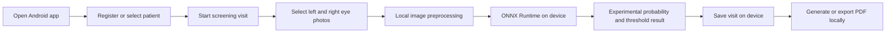
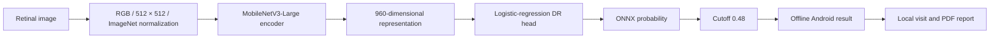

<div align="center">

# OFFIRST — Learn More From Less Data

### Offline Retinal Screening Through Self-Supervised and Contrastive Representation Learning

**Team OFFIRST · ZEISS BeyondCode 2026**

[](https://github.com/Mayank-gitspace/OFFIRST/releases/tag/offirst-android-prototype-v1.1)
[](deployment/offline_dr_screening/MOBILE_OPTIMIZATION.md)
[](deployment/offline_dr_screening/README.md)
[](tools/README.md)
[](encoder_mnv3_ssl/README.md)

[**Download Android**](https://github.com/Mayank-gitspace/OFFIRST/releases/download/offirst-android-prototype-v1.1/app-arm64-v8a-release.apk) ·
[iOS status](#ios-availability) ·
[Demo video: unavailable](#demo-and-screenshots) ·
[Screenshots: unavailable](#demo-and-screenshots) ·
[Architecture](docs/ARCHITECTURE.md) ·
[Research results](docs/RESEARCH_RESULTS.md) ·
[Installation](docs/INSTALLATION.md)

**Experimental academic research prototype. It is not validated for independent clinical diagnosis and must not guide treatment.**

</div>

## 1. Overview

Retinal screening can be difficult where specialist access and reliable connectivity are limited. OFFIRST explores whether useful retinal representations can be learned from limited labeled data and used in a local mobile screening workflow. The Android application runs inference on the device; it does not require cloud inference.

The goal is to **learn more from less labeled data while enabling an offline screening workflow**. Research experiments and the shipped classifier are distinct: the current app ships the v1.1 DR classifier described below, not the experimental v2 or v2.1 candidates.

## 2. Download the app

### Android

**[Download the recommended ARM64 APK](https://github.com/Mayank-gitspace/OFFIRST/releases/download/offirst-android-prototype-v1.1/app-arm64-v8a-release.apk)** · [ARMv7 APK](https://github.com/Mayank-gitspace/OFFIRST/releases/download/offirst-android-prototype-v1.1/app-armeabi-v7a-release.apk) · [Release notes and checksums](https://github.com/Mayank-gitspace/OFFIRST/releases/tag/offirst-android-prototype-v1.1)

Use ARM64 on a typical recent Android phone. The release contains ARM64 (`arm64-v8a`) and 32-bit ARM (`armeabi-v7a`) builds. The ARM64 artifact was prepared for Android 7.0 or newer on a 4 KiB page-size device; the ARMv7 package has not had a corresponding device test. Neither artifact is verified on 16 KiB page-size devices. APKs are signed with the prototype's debug certificate.

### iOS availability

**iOS — Not yet available.** No verified iOS build, signing configuration, TestFlight distribution, or IPA was found. iOS packaging, native runtime integration, signing, and device validation remain pending. See [future iOS requirements](docs/INSTALLATION.md#ios-status).

## 3. Demo and screenshots

**Application screenshots: unavailable.** There was no running emulator or connected Android device in the publication environment. No synthetic UI mockups are presented as captures of the working application. The release readiness report describes a synthetic-data device checklist for producing genuine, de-identified screenshots.

**Demonstration video: unavailable.** No existing real application video was found, and a recording environment was not available for this publication.

## 4. How OFFIRST works



The workflow supports multiple photographs for each eye, but it does not aggregate them into a single patient score. Images, visit metadata, and reports are stored locally. Android pickers may show cloud-backed providers, but inference and report generation do not send images to a server. Use fictitious patient records and de-identified images; exported PDFs can contain patient details and images.

## 5. AI architecture

The application packages the **OFFIRST v1.1** ONNX classifier: a MobileNetV3-Large encoder, BYOL plus Masked InfoNCE pretraining, and the epoch 3 encoder with a 960-dimensional representation feeding a logistic-regression DR head. The model emits a probability and the fixed decision cutoff is **0.48**. App preprocessing converts to RGB, resizes to 512 × 512, applies ImageNet normalization, and sends NCHW float32 input to ONNX Runtime on Android.

BYOL is a non-contrastive self-supervised method. Masked InfoNCE is the explicit contrastive component in this pretraining recipe.



The model is not a validated diagnostic system. See [model contract and provenance](docs/AI_MODEL.md) and [application architecture](docs/ARCHITECTURE.md).

## 6. What makes OFFIRST different?

- On-device inference and local visit/report workflow that can run without cloud inference.
- Compact MobileNetV3-Large inference through ONNX Runtime.
- Explicit contrastive pretraining experiments alongside BYOL and knowledge-distillation studies.
- Bilateral eye visit workflow, local persistence, and exportable PDF reports.
- Reproducible comparisons and audits in the preserved research repository.

These engineering and research choices do not establish better clinical performance.

## 7. Research and experiments

The repository preserves the research history and separates the following lines of work:

| Experiment | Description | Status |
| --- | --- | --- |
| A. BYOL + Masked InfoNCE, epoch 3 | Deployed v1.1 MobileNetV3-Large encoder and DR classifier | Shipped in Android prototype |
| B. Direct BYOL MobileNetV3, epoch 40 | Separate encoder pretraining experiment | Research only |
| C. Knowledge-distilled MobileNetV3, epoch 40 | Frozen teacher / student feature-matching experiment; not explicit InfoNCE | Research only |
| D. Experimental v2 DR classifier | Candidate model and evaluation work | Not shipped; did not pass all acceptance gates |
| E. Experimental v2.1 conventional-fundus DR classifier | Candidate for a narrower acquisition setting | Not shipped; did not pass all acceptance gates |

Browse [BYOL experiments](encoder_byol/README.md), [MobileNetV3 SSL](encoder_mnv3_ssl/README.md), [knowledge distillation](kd_run2/README.md), [imaging analyses](kd_imaging/README.md), [baselines](encoder_baseline/README.md), [lesion segmentation](lesion_segmenter/README.md), and [tools](tools/README.md). The distillation run is a separate teacher/student experiment and should not be read as explicit contrastive learning.

## 8. Evaluation and limitations

In an external exploratory DeepDRiD benchmark, the released v1.1 model was scored on **1,742 images from 488 patients** at the unchanged 0.48 cutoff:

| Accuracy | Sensitivity | Specificity | AUROC |
| ---: | ---: | ---: | ---: |
| 54.54% | 21.47% | 98.27% | 0.764 |

This benchmark has unresolved historical training-exposure and label-definition limitations; it is not an independent clinical validation. The low sensitivity means false negatives are a substantial limitation. A retrospective threshold sweep did not find an operating point meeting both 85% accuracy and sensitivity goals. The v1.1 model and cutoff remain unchanged. The v2 and v2.1 candidates did not pass all acceptance gates.

The source audit reports 13 Flutter tests passed, 24 preprocessing fixtures matched, and a prior ARM64 emulator offline workflow covering bilateral screening, visit persistence, and PDF export. Those checks are recorded evidence from earlier runs, not checks executed by this documentation publication. Physical-device testing remains incomplete. Preprocessing parity and emulator workflow success do not establish diagnostic reliability.

See [detailed results and caveats](docs/RESEARCH_RESULTS.md), [known limitations](docs/KNOWN_LIMITATIONS.md), and the [v1.1 readiness report](deployment/offline_dr_screening/RELEASE_READINESS_V1_1.md).

## 9. Technical stack

| Area | Technology and responsibility |
| --- | --- |
| Mobile app | Flutter / Dart; patients, visits, preprocessing, report flow |
| Inference | ONNX / ONNX Runtime 1.15.1 CPU libraries for Android ARM ABIs |
| Native image support | CMake and pinned libjpeg-turbo 3.1.1 shim for JPEG preprocessing parity |
| Research | Python and PyTorch; training, evaluation, and reproducibility scripts |
| Data science | NumPy, Pillow, scikit-learn and related pinned experiment dependencies |
| Training environment | Kaggle for model training and experiments |
| Local storage | JSON metadata and app-private image/report files; no application-level encryption |

## 10. Installation and usage

For phone installation, APK architecture, permissions and troubleshooting, see the [installation guide](docs/INSTALLATION.md). The [app user guide](docs/APP_USER_GUIDE.md) walks through a synthetic bilateral screening workflow.

For a developer checkout, install Flutter **3.41.9**, JDK 17, Android SDK/NDK compatible with that Flutter SDK, CMake 3.22.1 and Ninja. Then run from the repository root:

```powershell
cd deployment/offline_dr_screening
flutter pub get
dart format --output=none --set-exit-if-changed lib test
flutter analyze
flutter test
flutter build apk --release --no-pub --target-platform android-arm64,android-arm --split-per-abi
```

Dependency versions are pinned in `pubspec.yaml` and `pubspec.lock`. See [development setup](docs/DEVELOPMENT_SETUP.md). Release variants use the project's debug signing configuration and are for evaluation, not production distribution.

## 11. Repository structure

```text
deployment/offline_dr_screening/  Flutter Android app, deployed v1.1 model, audits
encoder_byol/                     BYOL teacher experiments
encoder_mnv3_ssl/                 MobileNetV3 self-supervised experiments
kd_run2/                          teacher/student knowledge distillation
kd_imaging/                       image and acquisition analyses
encoder_baseline/                 supervised encoder baselines
lesion_segmenter/                 lesion segmentation research
tools/                            shared research and quality tools
docs/                             reviewer, user, model, and setup guides
```

Research artifacts and historical commits are retained; datasets are not redistributed through the app package. The exact v1.1 ONNX asset is checked into the source tree and its checksum is documented in [the model guide](docs/AI_MODEL.md). Android APK downloads are release assets, not source-tree binaries.

## 12. Reproducibility

Evaluation scripts, preprocessing definitions, manifests and reports live beside their experiments. Start with the [research results guide](docs/RESEARCH_RESULTS.md), then follow each experiment's README. Some scripts require private or licensed data and external Kaggle inputs that are not included. Do not commit restricted datasets, patient records, credentials, or private medical images.

## 13. Team

**Team OFFIRST**, submitting in the ZEISS BeyondCode 2026 hackathon context. Existing repository materials do not provide a verified roster with member roles and profile links, so this page does not infer them.

## 14. Academic and medical disclaimer

OFFIRST is an experimental academic research prototype. It is not an approved medical device and must not be used as a substitute for assessment by a qualified clinician. It may miss disease, and clinical generalization, acquisition robustness, and performance on physical Android devices are unverified. Do not use its scores for diagnosis, treatment, referral, or other clinical decisions.

## 15. License and acknowledgements

No repository-wide source-code license was found; no license is implied by public visibility. Third-party code, runtime libraries and datasets retain their own licenses and attribution terms. Dataset availability does not imply permission to redistribute images. The app's JPEG shim credits and license are documented in [the app README](deployment/offline_dr_screening/README.md). ZEISS BeyondCode is the hackathon context and does not imply ZEISS product endorsement.
