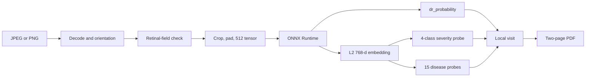
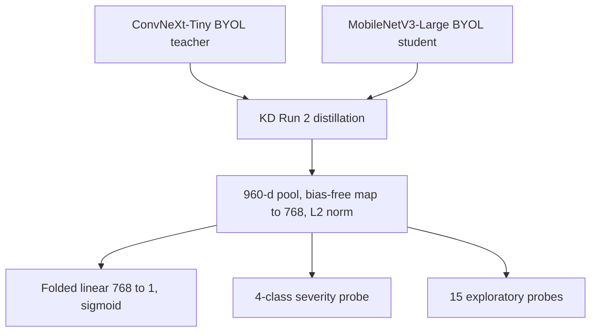

<div align="center">
  <h1>OFFIRST — Offline AI-Powered Retinal Disease Screening</h1>
  <h2>Learn More From Less Data</h2>
  <p><strong>Team OFFIRST | ZEISS BeyondCode 2026</strong></p>
  <p>
    
    
    
    
  </p>
</div>

OFFIRST is an offline Android research prototype. A phone can register a patient, screen retinal photographs, store the visit, and write a two-page PDF. The model runs on the device.

> **Research use only.** OFFIRST is not a certified medical device and has not been clinically validated. Do not use it to diagnose or rule out disease, determine referrals, or guide treatment. A score below a threshold does not rule out diabetic retinopathy.

## Download

**OFFIRST Android v1.0.5 (Build 2005)**

[Download the ARM64 APK](https://github.com/Mayank-gitspace/OFFIRST/releases/download/offirst-1.0.5/OFFIRST-1.0.5-arm64-v8a.apk) · [Release notes](https://github.com/Mayank-gitspace/OFFIRST/releases/tag/offirst-1.0.5) · [SHA-256 file](https://github.com/Mayank-gitspace/OFFIRST/releases/download/offirst-1.0.5/OFFIRST-1.0.5-arm64-v8a.sha256) · [Install steps](docs/INSTALLATION.md)

| Item | Verified value |
| --- | --- |
| Release | [offirst-1.0.5](https://github.com/Mayank-gitspace/OFFIRST/releases/tag/offirst-1.0.5) |
| Version name | 1.0.5 |
| Flutter build number | 2005 (`1.0.5+2005` in [pubspec.yaml](deployment/offline_dr_screening/pubspec.yaml)) |
| Android version code | **4005**. The ARM64 split uses `2 × 1000 + 2005`. |
| Package | `org.offirst.offline_dr_screening`, label **OFFIRST** |
| Android | 7.0 / API 24 through target API 36 |
| ABI | `arm64-v8a` only |
| Size | 48,185,982 bytes |
| APK SHA-256 | `62f319ef5978a13fa645a619cdc05802b6020ebfa085ac882fd9647c0e125a2d` |
| Signing | Debug certificate, `CN=Android Debug`. Certificate SHA-256 `08e09b07b3e9e052535d6e34219b4d50f3e320e41da40dcd764f60982d226bc7`. |
| ONNX in the APK | `b6bcb1182db7717c01ef24181d79a44be7d1a75ddefe8567cfec2fffb9e5c59b`, same bytes as the source asset |

Open the APK on an ARM64 phone and allow that source to install it. An existing OFFIRST install with this debug signature keeps its local records. Do not clear application data. An ARMv7-only phone cannot install this split.

The previous universal download is [OFFIRST 1.0.3](https://github.com/Mayank-gitspace/OFFIRST/releases/download/offirst-v2.1/OFFIRST-v2.1-final-candidate.apk) on [offirst-v2.1](https://github.com/Mayank-gitspace/OFFIRST/releases/tag/offirst-v2.1). That file is version code 2003 and an earlier model. Keep it as history.

<details>
<summary>What was verified, and what was not</summary>

Verified in the repository audit on 27 November 2026:

- GitHub asset digest for `OFFIRST-1.0.5-arm64-v8a.apk` is `sha256:62f319ef5978a13fa645a619cdc05802b6020ebfa085ac882fd9647c0e125a2d`.
- The same bytes report `versionName=1.0.5`, `versionCode=4005`, `native-code=arm64-v8a`, `minSdk=24`, and the Android debug certificate above.
- The ONNX file and both JSON probes inside that APK match the files in the current application tree.
- `pubspec.yaml` on `main` is `1.0.5+2005`.
- The application directory has not changed since commit [`212cf1f`](https://github.com/Mayank-gitspace/OFFIRST/commit/212cf1f012ba862cc05315b353960a9549205e4c). Later commits change documentation only.
- Release tag `offirst-1.0.5` points at [`a491bb2`](https://github.com/Mayank-gitspace/OFFIRST/commit/a491bb258c8b207f35ccd13e73fa197d80d51781). That commit contains the same application tree.

Not verified by rebuilding or by a new device test in that audit:

- A clean rebuild was not repeated, so the APK is asset-matched to the source rather than reproduced byte for byte from a commit.
- Install, screening, and PDF viewing were not repeated on a phone during the audit.
- No ARMv7 1.0.5 APK is published. An older 1.0.5 ARMv7 file exists only as a local build from before the current retinal-field check.

</details>

## Contents

- [Overview](#overview)
- [Features](#features)
- [Install](#install)
- [Screenshots](#screenshots)
- [Architecture](#architecture)
- [Screening modes](#screening-modes)
- [Research](#research)
- [Stack](#stack)
- [Repository map](#repository-map)
- [Build from source](#build-from-source)
- [Privacy and responsible use](#privacy-and-responsible-use)
- [Releases](#releases)
- [Team](#team)

## Overview

The research question is whether a compact mobile model can learn useful retinal representations from limited disease labels. OFFIRST studies that with self-supervised pretraining, knowledge distillation into MobileNetV3-Large, and small probes on a frozen 768-dimensional embedding.

Application version **1.0.5** is the Android prototype. Model-lineage name **v2.1** is the KD768 encoder export used by that prototype. Those names refer to different layers: 1.0.5 is the app build, and v2.1 is the encoder family. The current binary head is a folded linear map. It is not the earlier 16-unit network.

## Features

- Home, Patients, Screening, Experts, and About. A first launch walks through the main path.
- Gallery or camera JPEG/PNG, up to 24 megapixels, for the right eye (OD) and the left eye (OS).
- A retinal-field check before the encoder. Gray borders, one labeled corner, a tighter crop, a mild offset, and a darker retina can pass. A normal photo, a blank page, and a tiny speck fail. The message is: “This image does not look like a fundus photograph. Choose a retinal image.”
- **DR severity**, the default mode: Healthy, Mild, Moderate, or Severe.
- **Multi-disease**, an exploratory second mode on the same embedding. Switching mode does not run the encoder again.
- A stored binary score. Positive means `dr_probability >= 0.524373471736908`.
- A two-page A4 PDF, `OFFIRST-{visit}-v6.pdf`. Page 1 has the report and colour grades. Page 2 shows the captured photographs. Image quality is marked “Not assessed.”
- Records stay in app-private storage. There is no cloud inference call.

## Install

1. Use an ARM64 phone on Android 7.0 or newer.
2. Download [OFFIRST-1.0.5-arm64-v8a.apk](https://github.com/Mayank-gitspace/OFFIRST/releases/download/offirst-1.0.5/OFFIRST-1.0.5-arm64-v8a.apk).
3. Compare its SHA-256 with `62f319ef5978a13fa645a619cdc05802b6020ebfa085ac882fd9647c0e125a2d`.
4. Open the file and allow installation from that source.
5. Launch **OFFIRST**. Use a synthetic patient and de-identified images.
6. Screen one retinal photograph and one ordinary photograph, switch modes, save the visit, and open the PDF.

Full steps are in [docs/INSTALLATION.md](docs/INSTALLATION.md).

## Screenshots

The repository does not contain screenshots of application 1.0.5. Launcher icons and research plots are not the current screening UI. An untracked `screen.jpeg` shows an older dialog and is not part of this release. The capture list for a device pass is in [docs/SCREENSHOTS.md](docs/SCREENSHOTS.md).

## Architecture





| Stage | What 1.0.5 uses |
| --- | --- |
| Teacher lineage | Frozen ConvNeXt-Tiny BYOL representation. The phone does not load the teacher. |
| Student | MobileNetV3-Large from KD Run 2. Masked InfoNCE is a separate research strand and is not this deployed distillation. |
| Embedding | 960 pooled features, bias-free linear map to 768, then L2 normalization. `z = emb / max(norm(emb), 1e-12)`. |
| ONNX | [offirst_v2_1_experimental.onnx](deployment/offline_dr_screening/assets/offirst_v2_1_experimental.onnx). Input `fundus_image`, float32 `[1, 3, 512, 512]`. Outputs `dr_probability` and `embedding`. |
| Binary head | Folded weights `768 → 1`, then sigmoid. The scaler is inside those weights. No Platt calibration step in this graph. |
| Threshold | `0.524373471736908`, from `head_balanced.threshold_youden_cv`. |
| Severity probe | [kd768_lp_dr_severity4_aptos.json](deployment/offline_dr_screening/assets/heads/kd768_lp_dr_severity4_aptos.json), SHA-256 `b7f64ce49be8a11e2e9abebbdf8ea2b73fe3760b12b413c16df85b80afa2e388`. Softmax, then argmax. Severe covers ICDR 3 and ICDR 4. |
| Disease probes | [kd768_lp_multidisease_rfmid_odir.json](deployment/offline_dr_screening/assets/heads/kd768_lp_multidisease_rfmid_odir.json), SHA-256 `2eaf44e6b3343a5821c6f4988d149766e9c18be10d69a00a609424c66157a0cc`. |
| Rollback asset | [offirst_dr_model.onnx](deployment/offline_dr_screening/assets/offirst_dr_model.onnx), SHA-256 `b8fc10191f69faef16f1dc92d08bf9542ee7e26f885767942e28292c5201dd90`. Selected only with `OFFIRST_EXPERIMENTAL_V21=false`. Historical cutoff `0.48`. |
| Preprocessing | Kotlin and OpenCV. Max-channel mask above 15, 5×5 opening, crop, square pad, resize through 640 then 512, ImageNet normalization. The field check uses its own mask and does not change that crop. |

Model id: `offirst-v2.1-experimental-b6bcb118`. The recorded KD checkpoint digest is `8bc239d22ffc4e786820f2151c99380a754bef930e42edea65022e1246f2096d` on the [kd-run2 release](https://github.com/Mayank-gitspace/OFFIRST/releases/tag/kd-run2). The phone loads the ONNX export.

## Screening modes

Both modes score one cached embedding.

| Mode | Screen |
| --- | --- |
| DR severity | Colour badge, confidence, four bars, and Any DR risk = `1 − P(Healthy)`. Colours `#22C55E`, `#EAB308`, `#F97316`, `#EF4444`. |
| Multi-disease | Summary badge **Any Disease Risk**, then 14 rows sorted by displayed risk. The DR row uses the four-class grade. |

Multi-disease labels: Any Disease Risk, Diabetic Retinopathy, Age-Related Macular Degeneration, Pathological Myopia, Glaucoma, Cataract, Hypertensive Retinopathy, Media Haze, Drusen, Branch Retinal Vein Occlusion, Tessellation (Tigroid Fundus), Laser Scars, Optic Disc Cupping, Optic Disc Pallor, and Optic Disc Edema. **MH is Media Haze.**

Hypertension uses its prevalence-matched cutoff, `0.8037505256809883`. Every other finding uses the greater of its Youden cutoff and 0.35. Low is below that cutoff. Borderline runs up to the greater of cutoff + 0.15 and 0.70. Elevated runs up to 0.88. High is at or above 0.88.

These disease rows are exploratory probe outputs.

## Research

Self-supervised BYOL trains a representation from image views without disease labels for that stage. Knowledge distillation then trains the MobileNetV3-Large student to match the ConvNeXt-Tiny teacher. Downstream probes freeze that embedding and fit small classifiers. That is the path from limited labels to a phone-sized model. It does not, by itself, establish clinical accuracy.

<details>
<summary>Historical classifier metrics, not the 1.0.5 head</summary>

These rows are the development assessment of earlier binary classifiers, copied from [docs/RESEARCH_RESULTS.md](docs/RESEARCH_RESULTS.md). They do not measure the current folded linear head or the JSON probes. Patient independence was not established. IDRiD and RFMiD use different label protocols. The earlier v2.1 rows missed the combined gates of 85% accuracy, 85% sensitivity, and 80% specificity.

| Classifier | Dataset | Images | Accuracy | Sensitivity | Specificity | AUROC | Threshold |
| --- | --- | ---: | ---: | ---: | ---: | ---: | ---: |
| v1.1 | IDRiD | 72 | 70.83% | 57.45% | 96.00% | 0.846 | 0.48 |
| Earlier v2.1 | IDRiD | 72 | 79.17% | 87.23% | 64.00% | 0.874 | 0.3675977844516245 |
| v1.1 | RFMiD | 69 | 86.96% | 100.00% | 84.48% | 0.967 | 0.48 |
| Earlier v2.1 | RFMiD | 69 | 81.16% | 54.55% | 86.21% | 0.875 | 0.3675977844516245 |

Accuracy, sensitivity, and specificity of the current 1.0.5 head are not established in this repository.

</details>

<details>
<summary>Representation probes, separate from the app score</summary>

Frozen-encoder AUROC from [docs/RESEARCH_RESULTS.md](docs/RESEARCH_RESULTS.md). These are not the deployed classifier’s accuracy.

| Evaluation | Direct BYOL MobileNetV3 | KD Run 2 MobileNetV3 |
| --- | ---: | ---: |
| RFMiD linear-probe AUROC | 0.917 | 0.932 |
| RFMiD 10-shot AUROC | 0.640 | 0.728 |
| ARMD 10-shot AUROC | 0.789 | 0.949 |

</details>

## Stack

| Layer | Choice |
| --- | --- |
| App | Flutter and Dart |
| Native image path | Kotlin and OpenCV 4.12 |
| Inference | ONNX Runtime, FP32 |
| Probes | JSON linear probes in Dart, on the normalized embedding |
| Reports | Android `PdfDocument`, offline |
| Storage | App-private files |

## Repository map

Start with [docs/README.md](docs/README.md).

| Path | Role |
| --- | --- |
| [deployment/offline_dr_screening](deployment/offline_dr_screening) | Android application, tests, packaged ONNX, and probes |
| [heads](heads) | Probe JSON used to prepare the app assets |
| [docs](docs) | Installation, architecture notes, and the documentation index |
| [encoder_byol](encoder_byol) | ConvNeXt BYOL research |
| [encoder_mnv3_ssl](encoder_mnv3_ssl) | MobileNetV3 self-supervised research |
| [kd_run2](kd_run2) | Knowledge-distillation experiments and the student lineage |
| [encoder_baseline](encoder_baseline) | Supervised encoder baselines |
| [kd_imaging](kd_imaging) | Imaging and representation studies |
| [lesion_segmenter](lesion_segmenter) | Separate segmentation research. It is not in the APK. |
| [tools](tools) | Evaluation utilities |
| Root `OFFIRST_*.md` | Audit notes. Several still describe the earlier ONNX contract. |

Directories were left in place so existing scripts and paths keep working.

## Build from source

The published APK was produced with Flutter split builds, `--build-name=1.0.5`, and `--build-number=2005`. The documented toolchain is Flutter 3.41.9 and JDK 17 in [docs/DEVELOPMENT_SETUP.md](docs/DEVELOPMENT_SETUP.md). This audit did not rebuild the APK.

```powershell
git clone https://github.com/Mayank-gitspace/OFFIRST.git
cd OFFIRST/deployment/offline_dr_screening
flutter pub get
flutter test
flutter build apk --release --split-per-abi --tree-shake-icons --build-name=1.0.5 --build-number=2005 --target-platform android-arm64
```

The ARM64 output is `build/app/outputs/flutter-apk/app-arm64-v8a-release.apk` with version code 4005. A universal APK numbered 2005 does not replace an installed 4005 package. Release builds of this prototype are debug-signed.

The v1.1 rollback build is:

```powershell
flutter build apk --release --dart-define=OFFIRST_EXPERIMENTAL_V21=false --build-name=1.0.5 --build-number=2005
```

`scripts/build_v2_1_final_candidate.ps1` still checks for 1.0.4. Use the Flutter command above for this source.

## Privacy and responsible use

- Use synthetic patients and de-identified images.
- The app has no accounts and no cloud model call.
- Records sit in app-private storage without application-level encryption. An exported PDF can leave the phone.
- The repository has no root `LICENSE` file. Dataset terms stay with each dataset. Model and weight redistribution is not granted by this page.
- ZEISS BeyondCode 2026 is the hackathon context. This prototype is not a ZEISS product.

## Releases

| Release | Role |
| --- | --- |
| [offirst-1.0.5](https://github.com/Mayank-gitspace/OFFIRST/releases/tag/offirst-1.0.5) | Current reviewer APK. Version name 1.0.5, version code 4005, ARM64. |
| [offirst-v2.1](https://github.com/Mayank-gitspace/OFFIRST/releases/tag/offirst-v2.1) | Historical app 1.0.3, version code 2003, universal APK. |
| [offirst-android-prototype-v1.1](https://github.com/Mayank-gitspace/OFFIRST/releases/tag/offirst-android-prototype-v1.1) | Older binary model. |
| [kd-run2](https://github.com/Mayank-gitspace/OFFIRST/releases/tag/kd-run2) | Student checkpoint. The phone does not load this file directly. |

## Team

**Team OFFIRST · ZEISS BeyondCode 2026.** The app uses Flutter, Kotlin, ONNX Runtime, and OpenCV. Research folders use PyTorch-based experiments that are not packaged in the APK.
