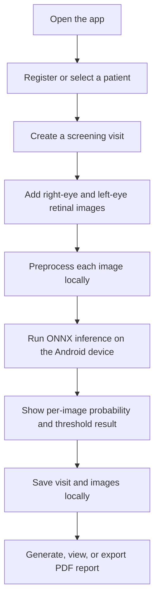

<div align="center">

# OFFIRST

### Learn More From Less Data

**Offline Retinal Screening Using Contrastive Representation Learning**

Team OFFIRST · ZEISS BeyondCode 2026

[](https://github.com/Mayank-gitspace/OFFIRST/releases/tag/offirst-android-prototype-v1.1)
[](deployment/offline_dr_screening/MOBILE_OPTIMIZATION.md)
[](deployment/offline_dr_screening/README.md)
[](encoder_mnv3_ssl/README.md)

**[Download OFFIRST for Android · ARM64](https://github.com/Mayank-gitspace/OFFIRST/releases/download/offirst-android-prototype-v1.1/app-arm64-v8a-release.apk)**

[ARMv7 APK](https://github.com/Mayank-gitspace/OFFIRST/releases/download/offirst-android-prototype-v1.1/app-armeabi-v7a-release.apk) · [Release page and checksums](https://github.com/Mayank-gitspace/OFFIRST/releases/tag/offirst-android-prototype-v1.1) · [Installation](docs/INSTALLATION.md) · [Architecture](docs/ARCHITECTURE.md) · [Research results](docs/RESEARCH_RESULTS.md)

**An experimental Flutter Android app for local diabetic retinopathy screening.** OFFIRST preprocesses retinal photographs on the phone, runs its ONNX model on-device, stores screening visits locally, and creates PDF reports.

</div>

## Overview

Retinal screening can depend on specialist access, medical equipment, and reliable connectivity. OFFIRST explores an offline approach using compact deep-learning representations learned from limited labeled images.

We built a Flutter Android application that accepts retinal photographs, preprocesses them locally, runs an ONNX classification model on the device, and displays an experimental screening result. Its research direction combines self-supervised learning with an explicit contrastive objective.

## Key features

- Offline ONNX inference on Android; retinal images are not sent to a cloud model.
- MobileNetV3-Large diabetic retinopathy classifier.
- Left-eye and right-eye screening, with a separate probability and threshold result for each image.
- Patient registration, selection, visit history, and local visit persistence.
- Local PDF report generation, viewing, and export.
- Android release APKs for ARM64 and ARMv7.

Multiple images can be recorded for each eye. Each image has its own model result; the app does not combine them into a single prediction.

## Download and install

| Device | Download |
| --- | --- |
| Most recent Android phones (ARM64) | [Download ARM64 APK](https://github.com/Mayank-gitspace/OFFIRST/releases/download/offirst-android-prototype-v1.1/app-arm64-v8a-release.apk) |
| 32-bit ARM Android (ARMv7) | [Download ARMv7 APK](https://github.com/Mayank-gitspace/OFFIRST/releases/download/offirst-android-prototype-v1.1/app-armeabi-v7a-release.apk) |

1. Download the APK for the device's processor architecture and open it from Downloads.
2. If Android prompts, allow installation from that browser or file manager and install OFFIRST.
3. Open the app and create or select a demonstration patient.
4. Start a visit, choose an eye, and select retinal images from the device.
5. Review the per-image results, save the visit, and open or export its PDF report.

The release is for Android 7.0 or newer. ARM64 is intended for 4 KiB page-size devices; 16 KiB page-size compatibility is unverified. The ARMv7 APK is available, though an ARMv7 device test is not recorded. APKs use the prototype's debug signing certificate. See the [installation guide](docs/INSTALLATION.md) for details.

## How OFFIRST works



The model and report workflow run on the device without cloud inference. Android's image picker may offer cloud-backed providers, but inference begins only after image bytes are available to the app. Patient and visit metadata, original images, and generated reports are stored in app-private files. Exported PDFs can contain patient details and images.

## AI architecture

The Android app packages the OFFIRST v1.1 model:

| Component | Deployed configuration |
| --- | --- |
| Encoder | MobileNetV3-Large, epoch 3 |
| Representation learning | BYOL + Masked InfoNCE |
| Feature representation | 960 dimensions |
| Classification head | Logistic regression for binary DR classification |
| Model and runtime | ONNX · ONNX Runtime 1.15.1 on Android CPU |
| Decision threshold | Fixed at 0.48 |

```mermaid
flowchart LR
  A[Retinal photograph] --> B[RGB conversion]
  B --> C[Resize to 512 × 512]
  C --> D[ImageNet normalization]
  D --> E[NCHW float32 tensor]
  E --> F[MobileNetV3-Large encoder]
  F --> G[960-dimensional representation]
  G --> H[Logistic-regression DR head]
  H --> I[ONNX probability]
  I --> J[0.48 threshold]
  J --> K[Experimental result in the Android app]
```



BYOL learns by matching related views without an explicit negative-pair loss. Masked InfoNCE supplies the explicit contrastive objective: it brings positive pairs together while distinguishing negative pairs. Read the [deployed model contract](docs/AI_MODEL.md) and [application architecture](docs/ARCHITECTURE.md).

## Technology stack

| Technology | Use in OFFIRST |
| --- | --- |
| Flutter 3.41.9 / Dart | Android app screens, patient and visit workflow, preprocessing orchestration |
| ONNX / ONNX Runtime 1.15.1 | On-device CPU inference |
| MobileNetV3-Large | Deployed image encoder and binary DR classifier |
| C / libjpeg-turbo 3.1.1 / CMake | JPEG decoding and audited preprocessing path |
| Kotlin / Android SDK | Native PDF generation with `PdfDocument`, PDF viewing and export actions |
| Python / PyTorch | Model development and research experiments |
| Pillow / NumPy / scikit-learn | Research preprocessing, evaluation, and analysis |
| JSON and app-private files | Local patient metadata, visit records, source images, and reports |
| Kaggle | Documented model training environment |

## Repository structure

```text
deployment/offline_dr_screening/  Flutter Android app and deployed v1.1 model
docs/                             App, model, setup, and evaluation guides
encoder_byol/                     Self-supervised learning research
encoder_mnv3_ssl/                 MobileNetV3 representation experiments
kd_run2/                          Preserved teacher/student research
encoder_baseline/                 Baseline model experiments
lesion_segmenter/                 Preserved segmentation research
tools/                            Research utilities
```

The Android app packages the specific v1.1 classifier described above. The repository also preserves the broader OFFIRST model-development and evaluation work. Start with the experiment READMEs: [BYOL](encoder_byol/README.md), [MobileNetV3 SSL](encoder_mnv3_ssl/README.md), [knowledge distillation](kd_run2/README.md), [baselines](encoder_baseline/README.md), [segmentation](lesion_segmenter/README.md), and [tools](tools/README.md).

## Verification and evaluation

### Engineering verification

- **13 Flutter tests passed**, including ONNX inference, patient and visit persistence, preprocessing, bilateral report actions, and the offline screening entry point.
- A prior preprocessing audit matched **24 Pillow fixtures** bit-for-bit for the input tensors and model probabilities.
- A previously recorded ARM64 emulator workflow exercised offline bilateral screening, saving and reopening a visit, and PDF export. Physical-device verification is not established by emulator testing.

See the [v1.1 release-readiness report](deployment/offline_dr_screening/RELEASE_READINESS_V1_1.md) and [preprocessing audit](deployment/offline_dr_screening/PREPROCESSING_AUDIT.md) for methods and scope.

### Exploratory model evaluation

On an external exploratory DeepDRiD cohort of 1,742 images from 488 patients, the deployed v1.1 model recorded:

| Accuracy | Sensitivity | Specificity | AUROC |
| ---: | ---: | ---: | ---: |
| 54.54% | 21.47% | 98.27% | 0.764 |

The low sensitivity indicates a substantial false-negative limitation. Historical training exposure and label-definition limitations remain unresolved; these results are not clinical validation. See [research results and caveats](docs/RESEARCH_RESULTS.md).

## Run from source

Install Flutter 3.41.9, JDK 17, Android SDK/NDK compatible with the Flutter project, CMake 3.22.1, and Ninja. From the repository root:

```powershell
cd deployment/offline_dr_screening
flutter pub get
dart format --output=none --set-exit-if-changed lib test
flutter analyze lib test
flutter test
flutter build apk --release --no-pub --target-platform android-arm64,android-arm --split-per-abi
```

The app's package versions are pinned in `pubspec.yaml` and `pubspec.lock`. See the [developer setup guide](docs/DEVELOPMENT_SETUP.md) for the host libraries and optional preprocessing audit configuration.

## Team and acknowledgements

**Team OFFIRST · ZEISS BeyondCode 2026.** The project uses Flutter, PyTorch, ONNX Runtime, and the other open-source components listed above. Third-party code and datasets remain subject to their own licenses and attribution terms. The Android JPEG shim's license information is in the [app documentation](deployment/offline_dr_screening/README.md). ZEISS BeyondCode is the hackathon context; this project does not imply product endorsement.

## Responsible use

OFFIRST is an experimental academic research prototype, not a certified medical device. Its screening results must not be used independently for diagnosis, referral, treatment, or clinical decision-making.
