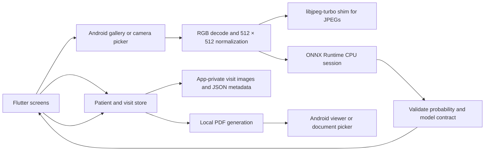

# OFFIRST architecture

## Runtime path

The app is in `deployment/offline_dr_screening`. Flutter/Dart owns the screens, local data flow, preprocessing orchestration, ONNX session calls and PDF actions. The pinned C shim uses libjpeg-turbo for JPEG decode and fixed-point resize support used to match the documented Pillow reference. ONNX Runtime executes on the Android CPU; there is no cloud inference service.

## Persistence and privacy

Patient and visit metadata is JSON in app-private support storage. Original image bytes are copied into visit and eye folders; reports are generated locally. Android backup is disabled. The prototype does not provide application-level encryption, app lock, or individual record deletion. Exported reports leave app-private storage and may contain identifying information. Use synthetic patient records and de-identified photos.

## Android packaging

The app packages ONNX Runtime 1.15.1 for ARM64 and ARMv7. It excludes x86 and x86_64 native runtimes. The release APKs use debug signing. The ONNX Runtime ELF load segments have 4 KiB alignment, so 16 KiB page-size device compatibility is not verified. See the [readiness report](../deployment/offline_dr_screening/RELEASE_READINESS_V1_1.md).

## Research pipeline

Python and PyTorch training/evaluation code is retained in the experiment directories. The BYOL + Masked InfoNCE model selected for v1.1 is separate from direct BYOL, teacher/student knowledge distillation, and v2/v2.1 research candidates. The Android package contains only the released v1.1 classifier.
