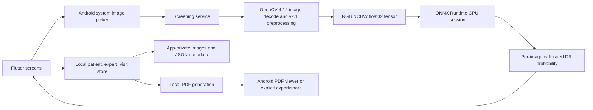

# OFFIRST application architecture

## On-device workflow

Flutter/Dart owns navigation, patient and expert forms, visit state, persistence calls, inference orchestration, result display, and PDF actions. The v2.1 Android path uses the packaged OpenCV library to preprocess the selected image, then runs the packaged FP32 ONNX classifier locally with ONNX Runtime. There is no cloud inference endpoint. The single application APK includes ARM64 and ARMv7 native libraries.

Each image is scored independently and saved with its eye, probability, model identifier, and threshold. Multiple images are not combined into a patient-level score. A result below threshold is not proof that disease is absent. Unpopulated eyes have no model assessment.

## Persistence and privacy

Patient, expert, and visit metadata and original image bytes are stored in app-private Android storage. The app supports local patient and expert CRUD and patient–expert association. It does not implement account authentication, cloud sync, clinician verification, or live scheduling. Expert records are user-entered and unverified; an association does not imply review.

Android backup is disabled. The prototype does not add application-level encryption or an app lock. PDF reports are generated locally. Opening or exporting a report is a user action; an exported copy leaves app-private storage and can contain identifying information or retinal images. Use synthetic patients and de-identified images.

## Model and build selection

The normal Flutter Android release build selects v2.1 by default. The v1.1 model remains packaged for rollback and legacy-record interpretation. Use `--dart-define=OFFIRST_EXPERIMENTAL_V21=false` only for a deliberate v1.1 rollback build. The v2.1 architecture, model hash, calibration, cutoff, and preprocessing are specified in [AI model details](AI_MODEL.md).

## Research lineage

The v2.1 student follows the BYOL + knowledge-distillation lineage: KD Run 2 MobileNetV3-Large epoch 40, distilled from a frozen ConvNeXt-Tiny BYOL epoch 20 teacher. This is separate from direct BYOL and any explicit Masked InfoNCE experiments. KD Run 2 is not an InfoNCE objective. The repository keeps those research strands in their own folders; only the v2.1 DR classifier is selected by the current app build.

## Android constraints

The application package ID is `org.offirst.offline_dr_screening`; minimum Android API is 24. The verified prototype APK is debug-signed, not production-signed. A device startup, upgrade, and real Android inference test was not performed for this release verification. Do not treat host tests or Python/ONNX replay as Android device evidence.
